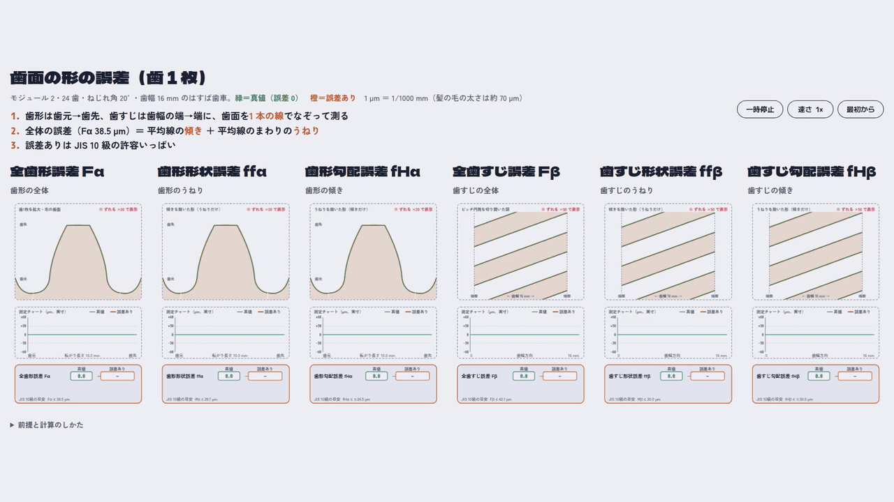
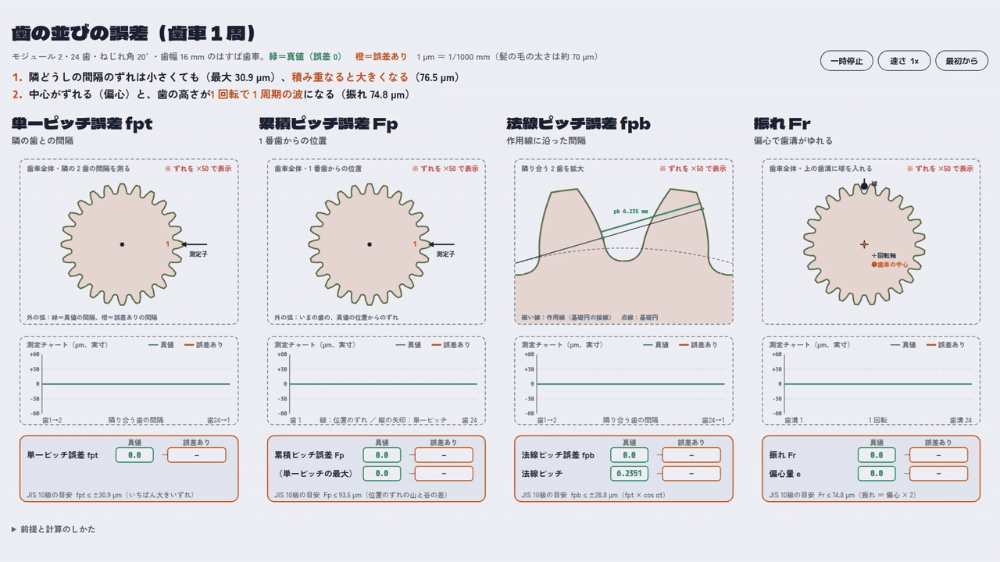
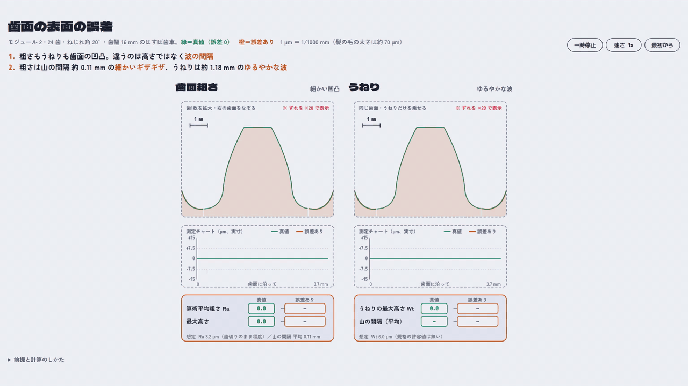
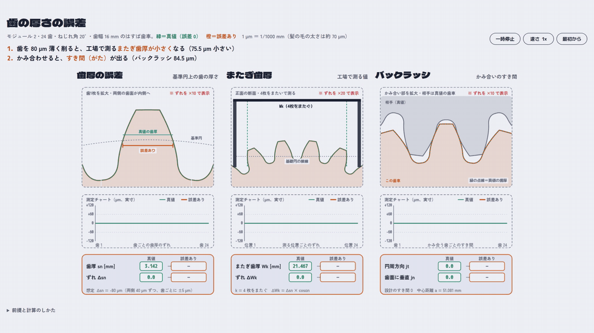
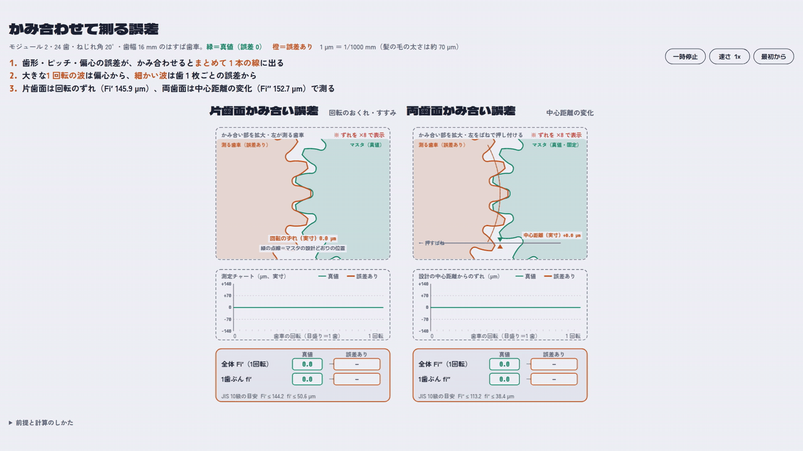
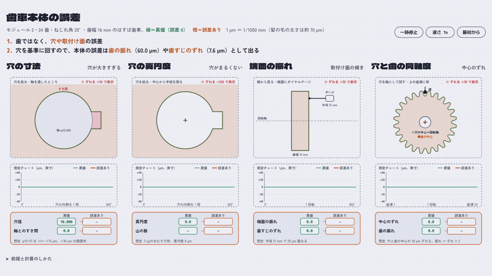
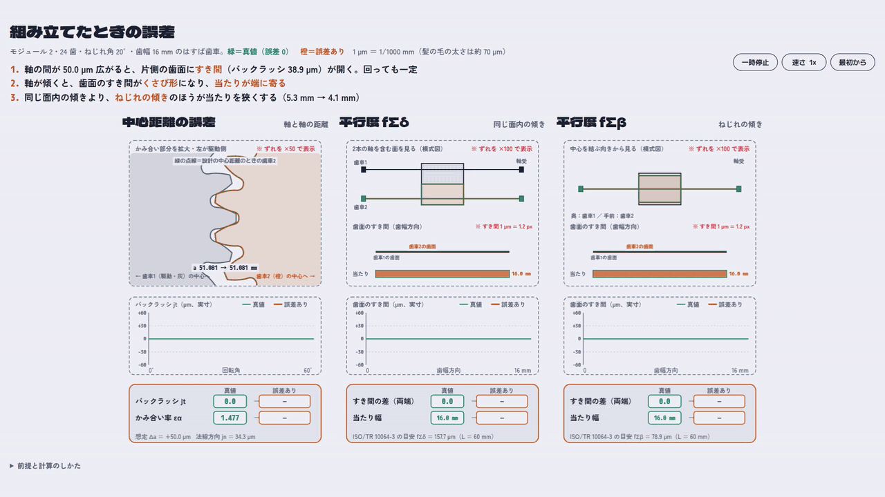

# はすば歯車の誤差を動きで見せる

モジュール 2・24 歯・ねじれ角 20°・歯幅 16 mm のはすば歯車で、真値（誤差 0）と誤差ありの歯車を並べて動かし、歯車の誤差の違いを見せる HTML アニメーションと MP4 です。
数字はすべてページ内のコードで計算しています。図の中のずれは拡大して描き、拡大率を図に書いています。チャートと数字は実寸です。

| # | 内容 | HTML | 動画 |
|---|---|---|---|
| 1 | 歯面の形の誤差（歯形・歯すじ） | [01-tooth-flank.html](01-tooth-flank.html) | [MP4](01-tooth-flank.mp4) |
| 2 | 歯の並びの誤差（ピッチ・振れ） | [02-tooth-spacing.html](02-tooth-spacing.html) | [MP4](02-tooth-spacing.mp4) |
| 3 | 歯面の表面の誤差（粗さ・うねり） | [03-tooth-surface.html](03-tooth-surface.html) | [MP4](03-tooth-surface.mp4) |
| 4 | 歯の厚さの誤差（歯厚・またぎ歯厚・バックラッシ） | [04-tooth-thickness.html](04-tooth-thickness.html) | [MP4](04-tooth-thickness.mp4) |
| 5 | かみ合わせて測る誤差（片歯面・両歯面） | [05-meshing-test.html](05-meshing-test.html) | [MP4](05-meshing-test.mp4) |
| 6 | 歯車本体の誤差（穴・端面・同軸度） | [06-gear-body.html](06-gear-body.html) | [MP4](06-gear-body.mp4) |
| 7 | 組み立てたときの誤差（中心距離・平行度） | [07-assembly.html](07-assembly.html) | [MP4](07-assembly.mp4) |

- 誤差ありの値は JIS B 1702-1:1998 の 10 級の式に実寸を入れた目安です。規格に値の無いものは想定値で、各パネルに書いています。
- かみ合いの場面（4・5・7）では、歯の輪郭の線と線の交点から「歯が重ならずに当たる位置」を計算して歯車を置いています（`src/_mesh.js`）。
- 正面断面のモデルです。はすば歯車の重なりかみ合いと、歯のたわみは扱っていません。

## アニメーション

### 1. 歯面の形の誤差（歯形・歯すじ）



[HTML](01-tooth-flank.html) ・ [MP4](01-tooth-flank.mp4)

### 2. 歯の並びの誤差（ピッチ・振れ）



[HTML](02-tooth-spacing.html) ・ [MP4](02-tooth-spacing.mp4)

### 3. 歯面の表面の誤差（粗さ・うねり）



[HTML](03-tooth-surface.html) ・ [MP4](03-tooth-surface.mp4)

### 4. 歯の厚さの誤差（歯厚・またぎ歯厚・バックラッシ）



[HTML](04-tooth-thickness.html) ・ [MP4](04-tooth-thickness.mp4)

### 5. かみ合わせて測る誤差（片歯面・両歯面）



[HTML](05-meshing-test.html) ・ [MP4](05-meshing-test.mp4)

### 6. 歯車本体の誤差（穴・端面・同軸度）



[HTML](06-gear-body.html) ・ [MP4](06-gear-body.mp4)

### 7. 組み立てたときの誤差（中心距離・平行度）



[HTML](07-assembly.html) ・ [MP4](07-assembly.mp4)

## 作り直し方

```bash
cd src
uv run python build.py g1   # g1〜g7 → ../01-*.html 〜 ../07-*.html
node check.js g5            # ページの数字を node で確かめる
```
